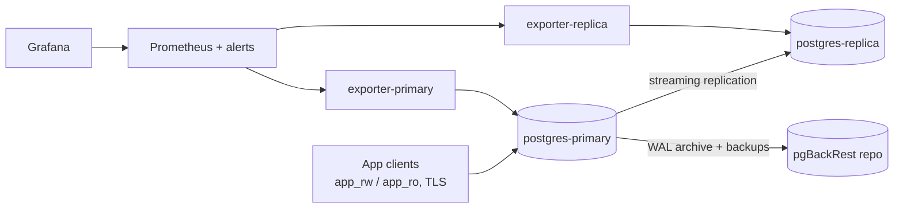
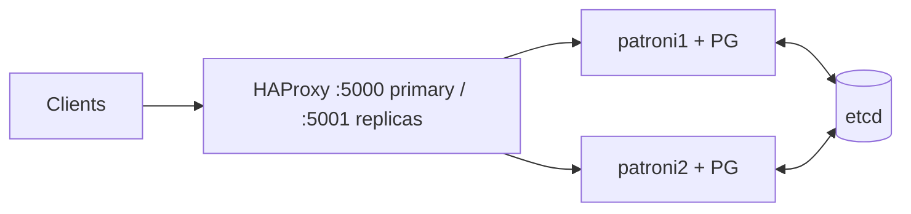

# Architecture

HA variant (`docker-compose.ha.yml`):

## Design decisions
| Decision | Why |
|---|---|
| pgBackRest with WAL archiving | Enables PITR, not just point-in-time snapshots |
| Roles split rw / ro / monitor / replicator | Least privilege; blast radius of a leaked credential is small |
| `hostssl` required for app roles | No plaintext app traffic |
| Untuned baseline config | Gives the tuning exercise an honest "before" |
| Patroni in a separate stack | Keeps the simple stack light; shows both manual and automated failover |

## What I'd do differently in production
- pgBackRest repo on S3/GCS with encryption, not a local volume (same host = not a real backup).
- Real CA-signed certs and `verify-full`; secrets from a vault, not `.env`.
- Three etcd nodes and a synchronous standby (`synchronous_mode`) where zero data loss matters.
- Connection pooling (PgBouncer) in front of the primary.
- Alertmanager routing to paging, plus log shipping (pgaudit and slow query logs) to a central store.
- Regularly scheduled automated restore tests, not just backups.
